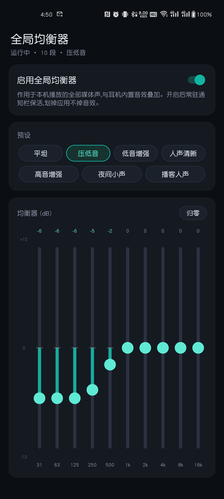
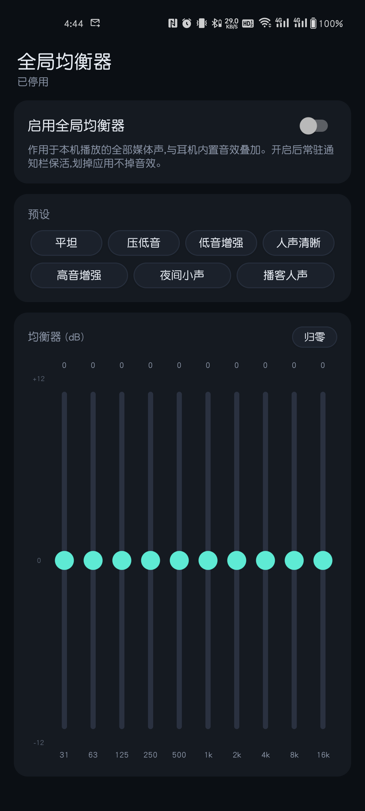

# Global EQ (全局均衡器)

[简体中文](README.md) | English

A **system-wide equalizer for Android**. It attaches an Android `DynamicsProcessing` effect to the global audio output mix (audio session 0) and applies per-band gain to **all media played on this phone** (music / video / games) — no EQ support required from the headphone firmware, and no Bluetooth permission needed.

<div align="center">
  
  
</div>


## Features

- **10-band equalizer** (31 Hz – 16 kHz), ±12 dB per band in 0.5 dB steps; the vertical faders are custom-drawn on Canvas, do not conflict with page scrolling, and give haptic feedback on touch
- **7 presets**: Flat / Bass Cut / Bass Boost / Vocal Clarity / Treble Boost / Night Listening / Podcast Voice. Preset curves are log-domain interpolated onto the actual band centers, so they adapt to any band count; touching a fader re-labels the state as "Custom"
- **Preamp** ±6 dB, with a **limiter always on** to prevent clipping
- **Foreground-service keep-alive**: an ongoing notification shows "Running · band count · current preset" with a one-tap *Disable* action; swiping the app away does not drop the effect
- **Auto-restore after boot**: switch state and curve survive reboots
- Everything (switch / per-band gains / preamp / preset name) is persisted locally and restored verbatim
- Dark theme, adaptive launcher icon; the APK is ~30 KB with **zero third-party dependencies**

## How it works

- Creates a `DynamicsProcessing` (stereo, pre-EQ, limiter on) and attaches it to **audio session 0** (the global output mix), so every media output path of this phone is processed;
- Band count is probed in the order `10 → 6 → 5 → 8 → 12`, using the first one the system accepts;
- `EqService` (foreground) holds the effect so the system won't reclaim it; `BootReceiver` rebuilds it after boot.

## Device / system requirements and limitations

| Item | Requirement / Notes |
| --- | --- |
| OS version | Android 9.0 (API 28)+ — `DynamicsProcessing` was introduced in API 28 |
| ROM effect support | The system must ship the AOSP `dynamics_processing` effect implementation (almost all devices do). A few heavily customized ROMs block third-party global effects; the app probes at startup and reports a clear error if unavailable |
| Scope | Only **media played on this phone**: works over Bluetooth headphones/speakers, wired and speaker outputs alike |
| Not affected | Voice calls; playback on **other source devices** (e.g. the headphones connected to a PC); a few hardware-offloaded playback paths may bypass the effect |
| Process survival | Aggressive battery cleanup or force-stop kills the effect. Allow "auto-start" and disable battery optimization for this app; the foreground service already improves survivability a lot |
| Notification permission | On Android 13+ the notification permission must be granted, otherwise the ongoing notification stays invisible (some Chinese ROMs silence notifications for adb-installed apps by default — **the effect itself still works**) |
| Effect stacking | Running another session-0 equalizer app at the same time stacks both effects — avoid double EQ |

## Build & install

No gradle — the SDK build-tools toolchain is used directly (aapt2 → javac → d8 → zipalign → apksigner):

```bash
bash build_app.sh
# output: build/GlobalEQ.apk
adb install -r build/GlobalEQ.apk
```

Requirements: Android SDK (platform android-34, build-tools 34.0.0 plus the d8 from 37.0.0) and JDK 21. Paths are defined at the top of the script.

First run: open the app → grant the notification permission → toggle "Enable global EQ" → pick a preset (Bass Cut) or drag the faders.


> For learning purposes only. Please comply with your local regulations.
